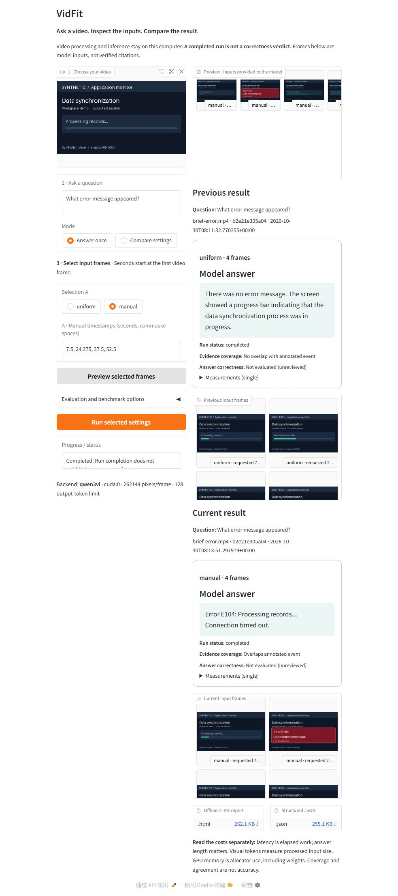

# VidFit

**A local research workbench for frame selection and video-language models.**

VidFit helps you study how the frames supplied to a video LLM affect its answers
and computational cost. Inspect source frames and processor behavior, compare
selection strategies, switch local models, and export the evidence behind each run.
Use the web interface for exploration, the CLI for repeated experiments, or the
Python API for your own selection policies.

[Quick start](#quick-start) · [Models](#model-support) ·
[Experiments](#run-a-selection-experiment) · [Measurements](#measurement-contract) ·
[Documentation](#documentation) · [Contributing](#contributing)



*Recorded Qwen run from the v0.2 interface. See the
[validation record](docs/validation.md) for tested configurations and limitations.*

## What you can study

- **Frame selection:** compare uniform midpoints, manual timestamps, and a simple
  visual-change baseline while preserving actual source indices, timestamps and RGB hashes.
- **Native sampling:** trace how a supported Qwen processor selects frames and
  compare its selection with VidFit's, without loading model weights.
- **Model behavior:** submit the same selected source frames to different local
  Hugging Face models, with explicit precision, revision and generation settings.
- **Accuracy versus cost:** run selected-4 / uniform-4 / uniform-16 experiments,
  include preprocessing in request time, and attach explicit answer judgments.
- **Reproducible evidence:** retain per-trial answers, inputs, settings, failures,
  timing and memory measurements in structured JSON and self-contained HTML.

The visual-change selector is a baseline for experiments: it picks the largest
change between consecutive 64×36 RGB thumbnails in each time bin, falling back to
the midpoint in static bins. It uses neither the question nor evaluation references.
Motion or a scene change does not necessarily identify useful evidence.

## Quick start

### 1. Explore without a GPU or model weights

Use **Python 3.10–3.13**; Python **3.12** is the locally validated version.
Clone the repository and create a virtual environment:

```sh
git clone https://github.com/xyhsy11/vidfit.git
cd vidfit
python -m venv .venv
```

Activate the environment:

- Linux / macOS: `source .venv/bin/activate`
- Windows PowerShell: `.\.venv\Scripts\Activate.ps1`

Then install the interface and generate a small synthetic video:

```sh
python -m pip install -e ".[ui]"
vidfit demo --output examples/generated/brief-error.mp4
vidfit ui --backend inspect --video examples/generated/brief-error.mp4
```

Open **http://127.0.0.1:7860**. Preview frames, change the selection, run an
inspection, and download its report. Inspection produces **no model answer**;
model-dependent measurements are marked unavailable. Reuse the demo file on later
runs: the generator refuses to overwrite it.

For CLI/API use without the interface, install `python -m pip install -e .`.
The [Windows setup guide](docs/model-switching.md#windows-setup-alongside-the-original-environment)
provides commands using full executable paths if you prefer not to activate an environment.

### 2. Add local model inference

The modern `vlm` profile pins PyTorch **2.8.0**, torchvision **0.23.0** and
Transformers **5.5.4**. The locally tested NVIDIA configuration uses CUDA 12.8 wheels:

```sh
python -m pip install torch==2.8.0 torchvision==0.23.0 --index-url https://download.pytorch.org/whl/cu128
python -m pip install -e ".[ui,vlm]"
vidfit ui --backend auto --model Qwen/Qwen3-VL-2B-Instruct --dtype float16
```

This configuration was exercised on Windows with an RTX 3080 Laptop GPU (16 GB);
it is a validation environment, not a minimum-memory requirement. CPU inference
requires explicit `--device cpu --dtype float32`. Apple MPS is not implemented.
Linux is covered by CPU CI; the recorded GPU runs were on Windows.

In the UI, choose a model, upload a video and enter a question. Select frames,
click **Preview selected frames**, then **Run selected settings**. Compare A/B
selections or keep the previous result beside the next one. Changing model or
selection settings requires a new preview. H.264 MP4 is the verified browser format.

Weights load on the first inference and download if uncached. Inference and video
processing run locally; initial package/model downloads need internet access.
The UI binds to loopback, disables Gradio sharing and analytics, and serializes
requests. Exported reports embed selected frames, so review them before sharing.

Install from source; no PyPI release is claimed. Choose one model dependency
profile per environment: `vlm` is the general starting point, while legacy `qwen`
pins Transformers 4.57.6 for earlier Qwen3-VL experiments. Do not combine those
profiles. See [runtime profiles and offline use](docs/model-switching.md).

## Model support

`vidfit models` lists presets without downloading anything. In the UI, a preset
sets precision and pixel limits. The CLI does not apply preset settings automatically;
pass the appropriate `--dtype` and `--max-pixels` when changing models.
`--backend auto` chooses an adapter from the checkpoint configuration.

| Tested checkpoint | Input representation in VidFit | Tested precision | Native sampling trace |
| --- | --- | --- | --- |
| `Qwen/Qwen3-VL-2B-Instruct` | Native video | FP16 | Yes |
| `Qwen/Qwen3.5-2B` | Native video | BF16 | Yes |
| `HuggingFaceTB/SmolVLM2-500M-Video-Instruct` | Timestamped images | BF16 | No |
| `llava-hf/llava-onevision-qwen2-0.5b-ov-hf` | Timestamped images | FP16 | No |

These checkpoints completed real inference and the starter selection experiment.
The SmolVLM2 2.2B preset is available but has not been locally validated. Custom
Hugging Face IDs work when the installed native `AutoModelForImageTextToText` class
and processor satisfy the adapter's input checks. Remote Python code is disabled;
compatibility with every visual LLM is not promised.

**Input representation matters.** Qwen receives selected frames through its native
video processor, without resampling. Generic models receive chronological images
with timestamp labels, even if the model also supports native video. Equal frame
counts do not imply equal visual-token counts, resolution or computational work.
Generic visual-token counts remain unavailable until a mapping is verified.

The current LLaVA image path can be very slow at 16 frames on the tested runtime.
[Diagnostics identified avoidable input-format and attention-dispatch costs](docs/validation.md#why-the-llava-16-frame-path-was-slow);
the isolated optimizations have **not** been integrated into the application.
Consult the [model guide](docs/model-switching.md) for processor constraints,
pixel budgets, thinking controls and pinned revisions.

## Compare inputs and answers

For a first real comparison on the generated demo, run one inference per selection:

```sh
vidfit compare --video examples/generated/brief-error.mp4 --question "What error message appeared?" --frame-budgets 4 16 --backend auto --model Qwen/Qwen3-VL-2B-Instruct --dtype float16 --execution-mode single --max-new-tokens 64 --output-dir reports/uniform-comparison
```

Open `reports/uniform-comparison/comparison.html` to inspect answers beside the
actual input frames, or use `comparison.json` for analysis. Add
`--timestamps 7.5 24.375 37.5 52.5` to include a manual four-frame selection that
covers the demo's brief error. Evidence being present does not guarantee a correct answer.

**Execution modes:** the UI defaults to one inference per configuration. CLI
`compare` defaults to **benchmark**: one separate first invocation for the comparison,
then one warmup and three measured trials per configuration. Use `--execution-mode single` as above
for an initial check. Inference failures remain visible; VidFit does not silently
change the model, precision, frame budget or device.

### Trace native Qwen sampling

With the model dependencies installed, inspect the chosen Qwen processor's sampler:

```sh
vidfit trace --video examples/generated/brief-error.mp4 --model Qwen/Qwen3-VL-2B-Instruct --frames 4 --native-mode matched --output-dir reports/native-trace
```

`matched` compares equal frame counts; `default` uses processor defaults; `fps`
accepts `--native-fps`. The UI exposes the same workflow under **How Qwen picks frames**.
The export records selected indices, decoded timestamps, overlap and processor
provenance. It loads configuration files but **no weights**, and runs neither full
visual preprocessing nor inference or attention analysis. Tracing does not change
the frames used for answering. See the [sampling contract](docs/measurement.md#native-sampling-traces).

<a id="compare-a-visual-change-selector-with-uniform-sampling"></a>

## Run a selection experiment

The experiment runner compares **visual-change 4**, **uniform midpoint 4**, and
**uniform midpoint 16**. Uniform here means VidFit's sampler, not Qwen's native
sampling policy. Each complete request includes source probing, decoding, selection,
model preprocessing, transfer and inference; model loading is recorded separately.

Prepare the five-clip, ten-question starter collection before running it:

```sh
python -m pip install av==16.0.1 Pillow==12.0.0 numpy==2.2.6
python examples/prepare_evaluation.py
vidfit experiment --collection examples/evaluation/starter.json --video-dir examples/generated/evaluation --backend auto --model Qwen/Qwen3-VL-2B-Instruct --dtype float16 --repeats 2 --max-pixels 262144 --max-new-tokens 64 --output-dir reports/selection-qwen3vl
```

Preparation generates three synthetic clips and downloads two public source videos,
verifying checksums and preserving license information. Encoder/library differences
can change generated bytes; follow the [evaluation guide](docs/evaluation.md) if
verification fails. Use a new output directory for each experiment. The runner
loads one model, records two warmups, and rotates selection order across questions.

| Output | Purpose |
| --- | --- |
| `summary.html` / `summary.json` | Aggregate costs, completion and reviewed correctness |
| `answers-for-review.json` | Deduplicated answers with selection method and timing hidden |
| `case-*/comparison.json` / `comparison.html` | Per-question answers, frames, settings and trials |
| `case-*/comparison.raw.json` | Original comparison records retained when judgments are applied |

Answers start **unreviewed**. Create explicit judgments against the independent
rubrics, then apply them:

```sh
vidfit review-experiment --output-dir reports/selection-qwen3vl --judgments reports/selection-qwen3vl/review.json
```

Write `review.json` as a JSON array of objects containing `answer_id`, `verdict`,
`method`, `reviewer` and `rationale`. Copy answer IDs from the review packet. Verdicts
are `correct`, `partially_correct`, `incorrect` or `unanswerable`; methods are
`human`, `agent` or `automated`. The [judgment guide](docs/evaluation.md#record-judgments)
explains their meanings. Strict success
means a fully correct supported answer or appropriate abstention on an unsupported
question. Repeated trials do not create additional independent questions.

The [four-model experiment and LLaVA diagnosis](docs/validation.md#four-model-selection-comparison-and-llava-diagnosis-2026-10-31)
record 240 measured requests with agent-reviewed answers. The earlier
[Qwen-only pilot](docs/visual-change-results.md) is a separate experiment. These
small studies exercise the research workflow; they are not a general model ranking
or evidence that visual-change selection consistently improves accuracy.

## Python API

Compare different selection policies on the same video and question:

```python
from vidfit import SelectionSpec, VideoAnalyzer

analyzer = VideoAnalyzer(
    backend="auto",  # Use "inspect" to examine frames without model weights.
    model="Qwen/Qwen3-VL-2B-Instruct",
    dtype="float16",
    max_new_tokens=64,
)
result = analyzer.compare(
    "examples/generated/brief-error.mp4",
    "What error message appeared?",
    selections=[
        SelectionSpec.visual_change(4),
        SelectionSpec.uniform(4),
        SelectionSpec.uniform(16),
    ],
    execution_mode="single",
)
result.export_html("reports/selection-comparison.html")
result.export_json("reports/selection-comparison.json")
```

Use `SelectionSpec.manual(timestamps)` to supply frames chosen by your own policy.
`analyzer.preview(video, selection)` decodes inputs without loading weights;
`analyzer.trace_sampling(video, selection)` returns a separate native Qwen trace.
For full request timing that includes source probing, use the experiment runner.

## Measurement contract

| Record | Meaning and boundary |
| --- | --- |
| Source evidence | Video checksum, source frame indices, actual presentation timestamps and RGB hashes; manual timestamps map to the nearest frame, with earlier frames winning ties |
| Processor/model provenance | Resolved checkpoint revisions, runtime versions, precision, representation and processor metadata; validation depth depends on the adapter |
| Timing | Separate preprocessing, transfer, generation and text-decoding costs; `experiment` also includes probing and selection in complete-request time |
| GPU memory | PyTorch peak allocated/reserved memory, including resident weights; not total device usage |
| Visual tokens | Validated on the native Qwen path; unavailable with a reason for the generic image adapter |
| Evaluation | Completion, annotated event overlap and explicitly reviewed answer correctness are separate fields |

Ordinary `compare` measures trials after shared metadata setup; model loading,
previews and exports are outside its trial timing. Experiment loading and warmups
are also excluded from complete-request averages. Compare matching timing fields,
not whichever number is smallest. Displayed frames are supplied inputs, not
model-verified citations or explanations of its attention.

For a reproducible result, record the VidFit commit, checkpoint and processor
commits, dependency versions, hardware, source hashes, selection policy, precision,
pixel/output budgets and review method. Pin Hugging Face checkpoints with
`--revision <commit>`; the default `main` is mutable. Preserve input representation
when interpreting cross-model costs. See the [full measurement contract](docs/measurement.md).

## Documentation

| Guide | Contents |
| --- | --- |
| [Model switching](docs/model-switching.md) | Runtime profiles, model controls, offline use and backend constraints |
| [Measurement](docs/measurement.md) | Timing boundaries, source identity, native traces and export schema |
| [Evaluation](docs/evaluation.md) | Starter media, licenses, references and explicit answer judgments |
| [Validation](docs/validation.md) | Recorded tests, real inference, four-model results and diagnostic limits |
| [Contributing](CONTRIBUTING.md) | Development practices, tests and measurement invariants |

## Current limitations

- Native video and sampling traces support dense Qwen3-VL and Qwen3.5 and require
  constant-frame-rate video. Native Qwen inference needs at least two distinct
  frames; a sampling trace can inspect a single frame.
- Generic image adapters support only validated processor layouts. Their selected
  images are not equivalent to a model's native video representation.
- Audio, Apple MPS, quantization, streaming and automatic out-of-memory recovery
  are not implemented. Inference uses one explicit CUDA device or float32 CPU.
- Long videos require full decoding passes. Embedded frame images can make exports
  large, and browser playback supports fewer formats than PyAV decoding.
- The visual-change baseline is not question-aware. The starter set is small and
  its references and published answer judgments have not had independent human review.

## Contributing

Useful contributions include native video adapters, verified attention/runtime
profiling, new frame-selection policies, larger licensed evaluation sets and
independent annotation review. Preserve source identity and measurement boundaries
when extending the pipeline; see [CONTRIBUTING.md](CONTRIBUTING.md).

```sh
python -m pip install -e ".[dev]"
python -m pytest -q
python -m ruff check .
python -m ruff format --check .
python -m build
```

Ordinary tests require no model weights, CUDA or network access. Real model,
processor and UI checks are opt-in; setup is documented in the guides above.
For a [bug report](https://github.com/xyhsy11/vidfit/issues), include the command,
model/revision, dependency versions, hardware and a minimal shareable reproduction.

VidFit source is licensed under [MIT](LICENSE). Model weights and third-party
videos retain their respective licenses. Generated reports, videos, weights and
machine-specific caches are excluded from Git.
